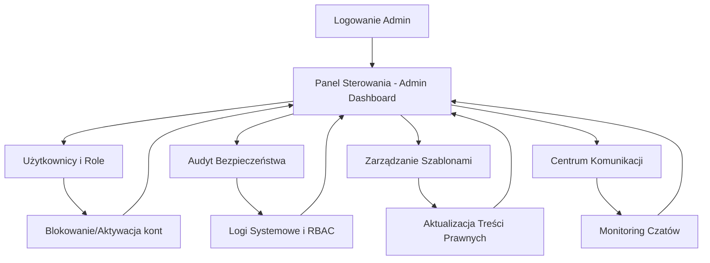

# Role: Administrator (System Admin)

Ten dokument opisuje funkcje nadzorcze i administracyjne w systemie LexPortal.

## Przepływ Informacji Administratora

## Odpowiedzialności Administratora

- **Nadzór nad Bezpieczeństwem**: Monitorowanie logów audytowych w celu wykrycia nieautoryzowanych prób dostępu.
- **Utrzymanie Szablonów**: Dodawanie nowych wzorów umów i aktualizacja istniejących zgodnie z nowelizacjami prawa (np. Kodeks Cywilny).
- **Zarządzanie Bazą Użytkowników**: Przypisywanie ról (Operator, Klient) i zarządzanie uprawnieniami RBAC.

## Przykładowy Scenariusz: Audyt Systemu

1. Administrator wchodzi w zakładkę "Logi Audytowe".
2. Filtruje zdarzenia według krytyczności lub użytkownika.
3. Weryfikuje, czy dostęp do wrapszych danych (NIP/PESEL) odbywa się zgodnie z polityką RODO.
4. Eksportuje raport bezpieczeństwa dla zarządu.
