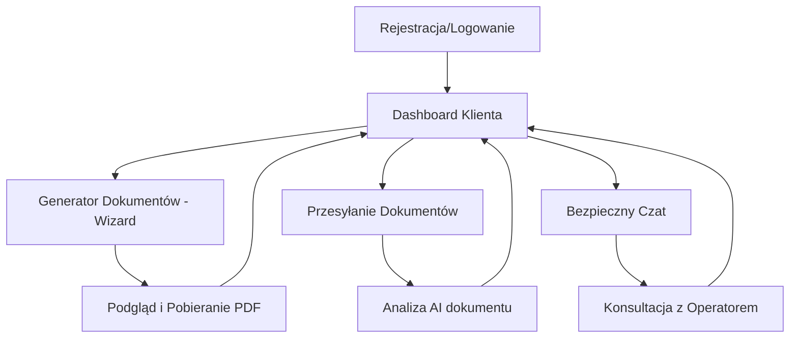

# Role: Klient (Zleceniodawca)

Ten dokument opisuje przepływ pracy i interakcje klienta w systemie LexPortal.

## Przepływ Informacji Klienta

## Odpowiedzialności i Możliwości Klienta

- **Samodzielne Tworzenie Dokumentów**: Korzystanie z inteligentnych formularzy do generowania umów.
- **Zasoby Sprawy**: Przechowywanie i zarządzanie własnymi dokumentami w chmurze (integracja z Google Drive).
- **Bezpieczeństwo**: Komunikacja z prawnikami w chronionym środowisku bez konieczności używania zewnętrznych komunikatorów.

## Przykładowy Scenariusz: Generowanie Umowy

1. Klient przechodzi do sekcji "Kreator Dokumentów".
2. Wypełnia formularz (np. Umowa o dzieło).
3. System generuje podgląd na żywo z uwzględnieniem klauzul RODO i kar umownych.
4. Klient pobiera gotowy plik PDF lub wysyła go do weryfikacji przez operatora.
