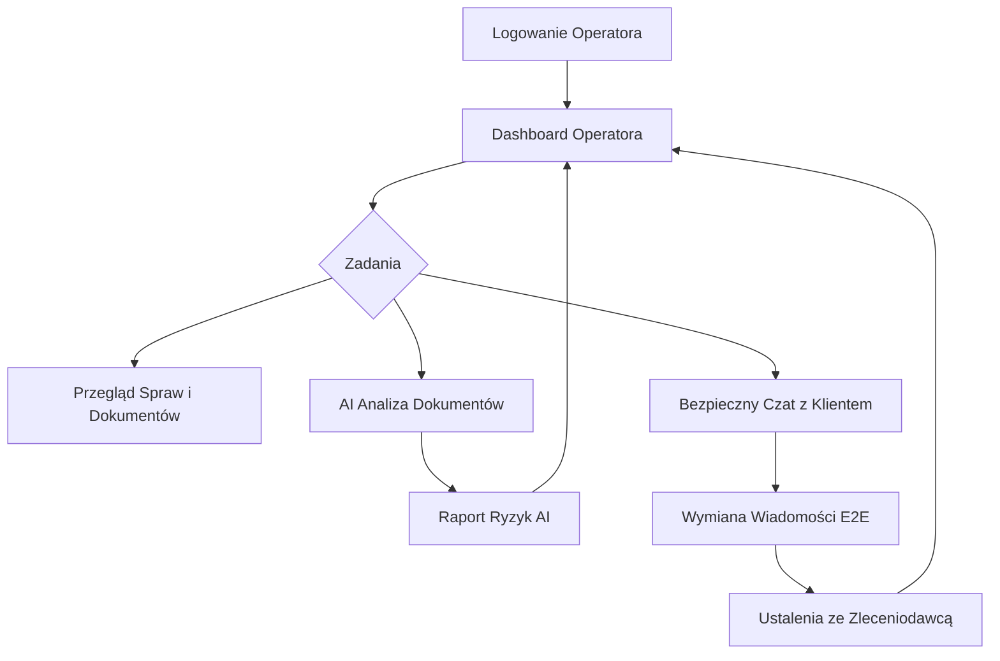

# Role: Operator (Prawnik/Operator)

Ten dokument opisuje przepływ pracy i system komunikacji z perspektywy Operatora w systemie LexPortal.

## Przepływ Informacji Operatora

## Odpowiedzialności Operatora

- **Zarządzanie Sprawami**: Przeglądanie i aktualizacja statusów spraw przypisanych do operatora.
- **Weryfikacja Dokumentów**: Wykorzystywanie silnika AI do automatycznej analizy ryzyk w dokumentach przesłanych przez klientów.
- **Komunikacja**: Bezpośredni, szyfrowany kontakt z klientem w celu wyjaśnienia szczegółów prawnych.

## Przykładowy Scenariusz: Konsultacja Sprawy

1. Operator loguje się do systemu.
2. Wybiera nową sprawę z list zadań.
3. Analizuje przesłaną umowę za pomocą narzędzia AI.
4. Przesyła uwagi do klienta za pomocą "Bezpiecznego Czatu".
5. Klient akceptuje zmiany lub przesyła nową wersję dokumentu.
